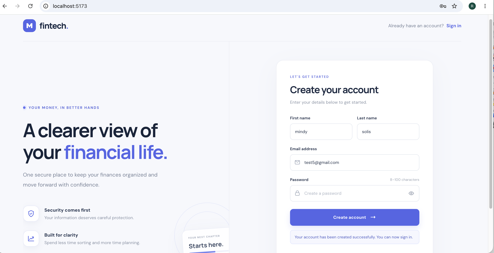
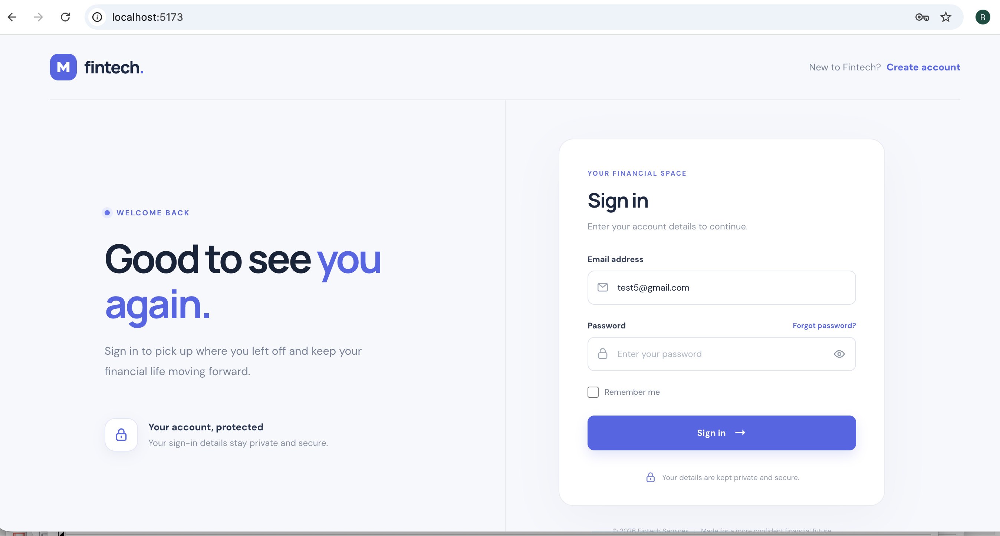
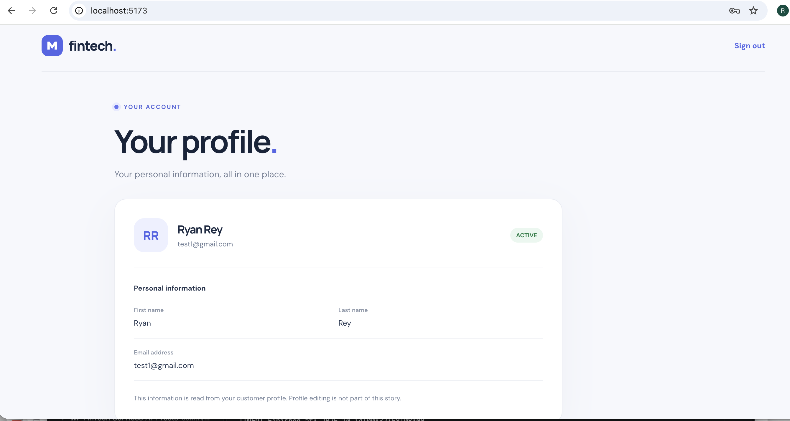
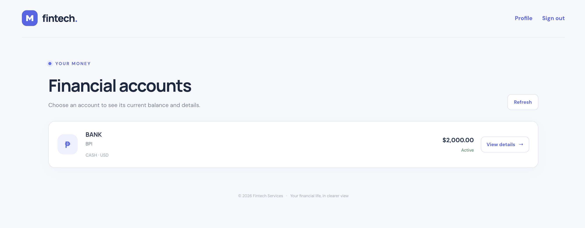
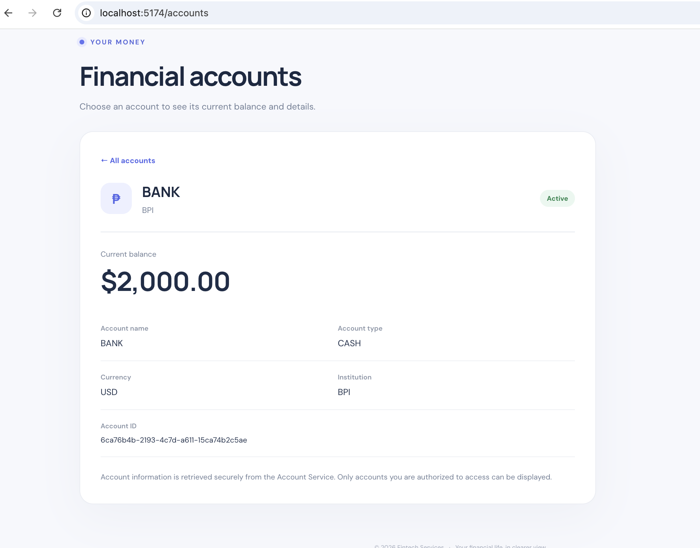
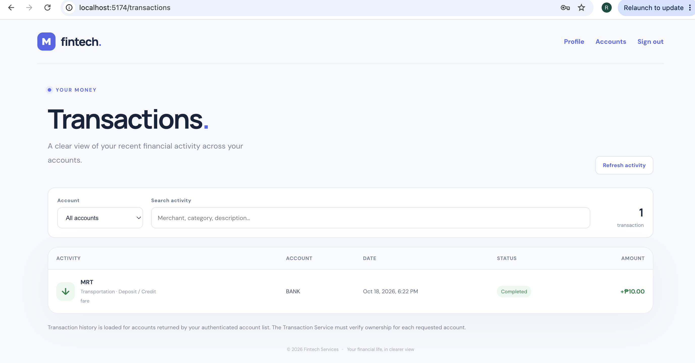
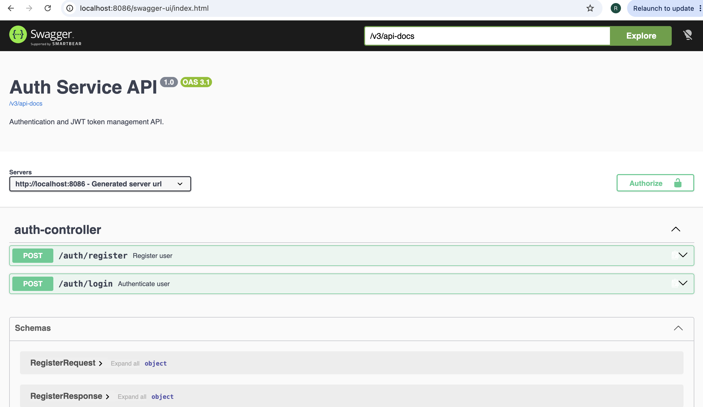
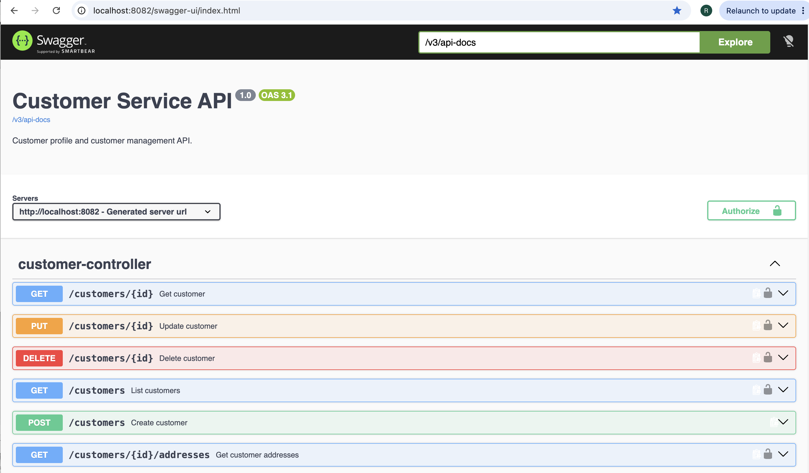
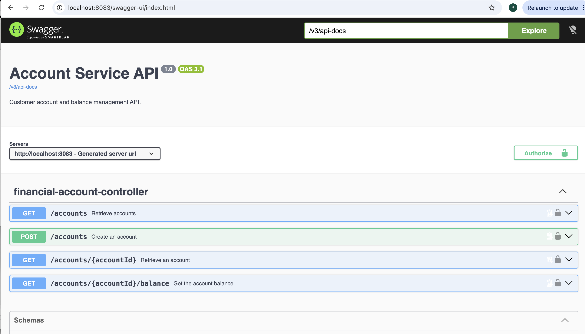
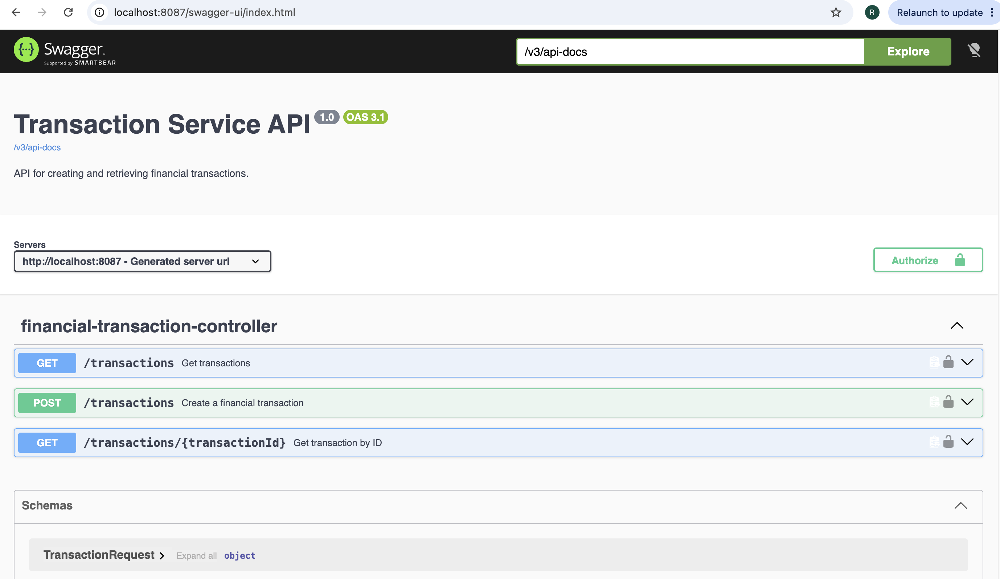

# FinTech Services

FinTech Services is a production-oriented financial services platform under active development. The project is being built as a collection of Spring Boot microservices using Java 21, PostgreSQL, Docker, and REST APIs.

The project focuses on building a realistic financial-services backend with clear service boundaries, domain ownership, security, persistence, validation, testing, and incremental architectural evolution.

> **Project status:** Active development

## Registration



## Login



## User Profile



## Accounts



## Account Details



## Transactions



## Auth Service Swagger UI



## Customer Service Swagger UI



## Accounts Service Swagger UI



## Transaction Service Swagger UI




# 🚀 Local Development: Build and Run the Platform

This section is the starting point for anyone cloning the repository. The commands below assume you are running them from the **repository root**.

## Prerequisites

For the Docker-based setup, install:

- [Git](https://git-scm.com/)
- [Docker Desktop](https://www.docker.com/products/docker-desktop/) (or Docker Engine with the Compose plugin)

Start Docker and confirm it is available:

```bash
docker --version
docker compose version
docker info
```

For running services directly on your machine instead of in Docker, install **JDK 21**. The frontend is maintained separately; see [Starting the frontend](#starting-the-frontend).

## 1. Clone the repository

```bash
git clone https://github.com/ryryanb/fintech-services.git
cd fintech-services
```

If you already have a checkout, change into the repository root before running the following commands.

## 2. Check the local configuration

The root `docker-compose.yml` defines the PostgreSQL databases and backend services. Before starting, validate the Compose file:

```bash
docker compose config
```

The Auth Service is configured to read its RSA private key from `auth-service/keys/jwt-private.pem`, mounted read-only into the container. Make sure that file exists locally and contains the key expected by your local Auth Service configuration. **Do not commit or publish private keys, passwords, or production secrets.**

The Compose file publishes these ports on your machine:

| Component | Local address / port |
| --- | --- |
| Auth Service | `http://localhost:8086` |
| Customer Service | `http://localhost:8082` |
| Account Service | `http://localhost:8083` |
| Transaction Service | `http://localhost:8087` |
| Auth PostgreSQL | `localhost:5436` |
| Customer PostgreSQL | `localhost:5433` |
| Account PostgreSQL | `localhost:5434` |
| Transaction PostgreSQL | `localhost:5437` |

The database credentials in the Compose file are **development-only defaults**. Do not reuse them in a production environment.

## Protecting local secrets (SEC-002)

Credentials are supplied through an untracked root `.env` file; the committed `.env.example` contains variable names and safe local-only sample values, never real credentials. Create your local file before running Compose:

```bash
cp .env.example .env
```

Replace every sample password with a unique local development password. Compose intentionally fails fast if a required database username or password is missing. Do not use these local values in shared, staging, or production environments. For deployment, inject credentials from the deployment platform's secret manager rather than committing an environment file.

The Auth Service signing key is also local-only: keep `auth-service/keys/jwt-private.pem` out of Git (it is ignored by `.gitignore`). Generate/provision a key locally and never paste a real private key into source control. Public verification keys may be committed when needed; private signing keys must not be.

## 3. Build and start the backend with Docker Compose

From the repository root, run:

```bash
docker compose up --build -d
```

This builds the service images and starts the configured containers in the background. The first build may take several minutes while Docker downloads base images and Maven dependencies.

Check container status:

```bash
docker compose ps
```

Follow logs for the full stack:

```bash
docker compose logs -f
```

Or follow one service at a time:

```bash
docker compose logs -f auth-service
docker compose logs -f customer-service
docker compose logs -f account-service
docker compose logs -f transaction-service
```

Press `Ctrl+C` to stop following logs; this does **not** stop the containers.

Allow the services time to initialize their databases and apply migrations. Confirm the service logs show successful startup before testing API requests. The Auth Service exposes its health endpoint at:

```bash
curl -i http://localhost:8086/actuator/health
```

The Compose network allows containers to reach each other by Compose service name (for example, `auth-service` connects to `customer-service:8082`). From your host machine, use `localhost` and the published ports shown above.

## 4. Rebuild or restart one service

After changing code in a service, rebuild and recreate just that service:

```bash
docker compose up -d --build --no-deps customer-service
```

Replace `customer-service` with `auth-service`, `account-service`, or `transaction-service` as needed. Use `--no-deps` when you deliberately want to leave dependencies untouched; make sure the required database and other services are already running.

To inspect the result:

```bash
docker compose ps customer-service
docker compose logs --tail=100 -f customer-service
```

## 5. Stop the platform

Stop and remove the containers and Compose network while retaining named database volumes:

```bash
docker compose down
```

To start the platform again without rebuilding:

```bash
docker compose up -d
```

**Database warning:** Do not use `docker compose down -v` unless you intentionally want to delete the Compose-managed database volumes and their data.

## Troubleshooting Docker

### A container name is already in use

The Compose file assigns fixed container names. If Docker reports that a name such as `/fintech-customer-db` is already in use, inspect the existing container before removing anything:

```bash
docker ps -a --filter "name=fintech-customer-db"
docker inspect fintech-customer-db \
  --format 'Status={{.State.Status}} Project={{index .Config.Labels "com.docker.compose.project"}}'
docker compose ps -a
docker compose ls
```

The existing container may belong to another checkout or Compose project. Do not remove a database container or volume until you have confirmed it is no longer needed. If it is the database you intend to use, verify that it is connected to the expected network and configured with the expected database.

### A service fails to start

Inspect its logs and validate the Compose configuration:

```bash
docker compose logs --tail=200 <service-name>
docker compose config
```

Check for missing local configuration files, port conflicts, database startup/migration errors, and unavailable dependencies before rebuilding.

## Running a backend service directly with Maven

For service-level development, you can run an individual Spring Boot service on your machine. Install JDK 21 first, start the required PostgreSQL database, and use that service's configured local datasource settings.

For example:

```bash
cd customer-service
./mvnw test
./mvnw spring-boot:run
```

The Customer Service listens on `http://localhost:8082`. Review the service's `application.yml` and its README before running outside Docker; database hostnames used inside Docker (such as `customer-db`) are not the same as host-side connection addresses (usually `localhost`).

## Starting the frontend

The React frontend is located in the `frontend/` directory of this repository. It uses React, TypeScript, and Vite.

### Prerequisites

Install the following:

* **Node.js 20.19+ or 22.12+**
* **npm**, which is included with Node.js
* Docker Engine with the Docker Compose plugin, if you also want to run the backend using Docker

### 1. Install frontend dependencies

From the repository root, run:

```bash
cd frontend
npm ci
```

`npm ci` installs the dependencies specified in `package-lock.json`. Use `npm install` instead if you intentionally need to update the dependency lockfile.

### 2. Start the frontend development server

Run:

```bash
npm run dev
```

Vite starts the development server at:

**http://localhost:5173**

Open this URL in your browser. Keep the terminal running while using the application. Press `Ctrl+C` to stop the development server.


The frontend can start without the backend, but registration, login, and profile features that make API requests require the relevant backend services and databases to be running.

### 3. Run frontend checks

From the `frontend/` directory, run the TypeScript checks:

```bash
npm run typecheck
```

Create a production build:

```bash
npm run build
```

The production-ready static files are generated in `frontend/dist/`.

To preview the production build locally, run:

```bash
npm run preview
```

Vite prints the local preview URL in the terminal. This preview server is intended for local verification, not production hosting.

### Available npm scripts

| Command             | Purpose                                      |
| ------------------- | -------------------------------------------- |
| `npm run dev`       | Start the Vite development server            |
| `npm run typecheck` | Check TypeScript types                       |
| `npm run build`     | Type-check and build the production frontend |
| `npm run preview`   | Preview the production build locally         |

### Important deployment note

The Vite proxy configuration is for local development only. For production deployment, serve the built frontend through a production web server or reverse proxy and configure `/api/auth/*` requests to reach the Auth Service and `/api/customers/*` requests to reach Customer Service. The production routing must preserve the expected backend paths and must not expose internal database ports publicly.

## What is and is not started by Docker Compose

The root `docker-compose.yml` starts the configured backend services and PostgreSQL databases. It does **not** start the React frontend. Start the frontend separately using the instructions above.

---

## 🎯 Project Goals

The project is designed to demonstrate practical backend engineering and distributed-system design through a realistic financial-services domain.

The primary goals are to demonstrate:

* Java 21 backend development
* Spring Boot microservices
* REST API design
* PostgreSQL persistence
* Database migrations with Flyway
* Authentication and authorization
* Domain-driven service boundaries
* Input validation and business rules
* Automated testing
* Docker-based development
* Incremental architecture evolution

Future development will extend the platform with transaction processing, payment services, and AI-assisted financial capabilities.

---

# 🏗 Current Architecture

The current repository contains four Spring Boot service modules:

```text
                         FinTech Services
                                │
       ┌────────────┬──────────────┬──────────────┐
       ▼            ▼              ▼              ▼
  Auth Service Customer Service Account Service Transaction Service
       │            │              │              │
       ▼            ▼              ▼              ▼
   Auth Data   Customer Data   Account Data   Transaction Data
       └────────────┴──────────────┴──────────────┘
                       PostgreSQL
```

Each service owns its own application logic and persistence model.

The architecture is intentionally being developed incrementally rather than introducing infrastructure before it is required.

---

# 📦 Implemented Services

## Auth Service

`auth-service`

Spring Boot service responsible for authentication and access control.

Current implementation includes:

* User registration
* User authentication
* Login
* JWT-based access tokens
* RSA-based JWT signing
* Spring Security integration
* Authentication-related persistence
* Request/response DTOs
* Validation and exception handling
* Security configuration
* Service-layer separation
* Automated tests

The service is organized into dedicated packages for controllers, DTOs, entities, repositories, services, security, configuration, and exceptions.

---

## Account ownership and isolation

Account Service endpoints derive the effective customer scope from the validated JWT `customerId` claim. Account-list requests are checked against that identity, while single-account and balance reads use customer-scoped database lookups (`accountId` plus `customerId`). An account that does not belong to the authenticated customer is treated as not found to avoid disclosing another customer's account existence. Do not use a customer ID supplied by the client as proof of ownership.

## Account Service

`account-service`

Spring Boot service responsible for financial account management.

Current implementation includes:

* Financial account creation
* Account persistence
* System-generated UUID identifiers
* Account-related DTOs
* Account domain entities
* Repository layer
* Service layer
* REST controller
* PostgreSQL persistence
* Docker-based development

The Account Service establishes the foundation for future financial-account functionality such as balances, account types, and account lifecycle management.

---

## Customer Service

`customer-service`

Spring Boot service responsible for customer information and customer-related business rules.

Current implementation includes:

* Customer registration
* Customer retrieval
* Customer information validation
* UUID-based customer identification
* Optional business customer numbers
* Customer status
* KYC status
* PostgreSQL persistence
* Jakarta Bean Validation
* JPA/Hibernate
* Unit testing with JUnit and Mockito
* Docker-based development

The service maintains ownership of customer information and does not own authentication or payment processing.

---

# 🧪 Testing

Testing is implemented at the individual service level.

Current services contain automated tests covering areas such as:

* Service-layer behavior
* Request validation
* Business rules
* Customer registration
* Error conditions

Tests can be executed using the Maven wrapper within each service:

```bash
cd customer-service
./mvnw test
```

The test strategy will expand as the platform evolves to include broader integration and end-to-end testing.

---

# 🗄 Technology Stack

## Backend

* Java 21
* Spring Boot
* Spring Web
* Spring Data JPA
* Hibernate
* Jakarta Bean Validation
* Spring Security
* Maven

## Database

* PostgreSQL
* Flyway

## Testing

* JUnit
* Mockito
* Spring testing support

## Infrastructure

* Docker
* Docker Compose

## API

* REST
* JSON
* JWT

---

# 🔐 Security

Security is a core architectural concern of the platform.

Current security work includes:

* JWT-based authentication
* RSA-based token signing
* Spring Security
* Authentication and authorization boundaries
* Request validation
* Separation of authentication responsibilities from business services

Security will continue to evolve as additional services are introduced.

Planned security improvements include:

* Service-to-service authorization
* More granular authorization policies
* Improved secret management
* Security-focused integration testing
* Additional production-hardening measures

---

# 🚧 Planned Services

The following capabilities are planned or still under development. A service module may exist before its full business functionality is complete.

## Transaction Service

`transaction-service` is present as a Spring Boot module and is included in the root Maven build and Docker Compose configuration. It is intended to own transaction-related functionality separately from payment-provider integration. The exact implemented API scope should be verified against the service source and tests.

Further development may include:

* Transaction creation
* Transaction retrieval
* Transaction lifecycle management
* Transaction validation
* Transaction history
* Transaction categorization
* Transaction-related business rules

The transaction domain will remain separate from payment-provider integration.

---

## Payment Service

A dedicated payment service is planned to isolate payment processing from transaction management.

Planned responsibilities include:

* Payment initiation
* Payment status management
* Payment-provider integration
* Payment lifecycle handling
* Provider-specific adapters
* Payment failure handling
* Idempotent payment operations

Potential payment-provider integrations include Stripe and PayPal.

---

# 🤖 Planned AI Capabilities

AI is a long-term extension of the platform rather than a replacement for the deterministic financial services.

The planned AI architecture follows an important principle:

> **AI assists with financial analysis and interaction; authoritative backend services remain the source of truth for financial state.**

Planned capabilities include:

### Financial Assistant

Natural-language interaction with financial information.

Examples:

```text
How much did I spend on food this month?

Why did my spending increase this month?

Show me my largest recurring expenses.

Can I afford to spend ₱5,000 this weekend?
```

### Spending Analysis

Potential capabilities include:

* Spending-pattern analysis
* Category analysis
* Recurring-expense identification
* Financial summaries
* Trend analysis

### Anomaly Detection

AI-assisted analysis may eventually identify potentially unusual financial activity and surface it to users.

### RAG

Retrieval-augmented generation may be introduced where it provides meaningful value, particularly for combining financial data with approved financial knowledge and contextual information.

### Agent Workflows

Agent-based workflows may eventually be introduced for selected financial tasks.

These capabilities remain **planned** and are not currently part of the implemented platform.

---

# 🗺 Development Roadmap

## Phase 1 — Core Services

**Current**

* [x] Authentication Service
* [x] Customer Service
* [x] Account Service
* [x] PostgreSQL persistence
* [x] REST APIs
* [x] JWT authentication
* [x] Service-level testing
* [x] Docker-based development

## Phase 2 — Financial Operations

**Planned**

* [x] Transaction Service module
* [ ] Transaction lifecycle
* [ ] Transaction history
* [ ] Transaction categorization
* [ ] Payment Service
* [ ] Payment-provider integration
* [ ] Payment idempotency
* [ ] Failure handling

## Phase 3 — Platform Hardening

**Planned**

* [ ] Integration testing
* [ ] End-to-end testing
* [ ] Service-to-service authorization
* [ ] Centralized configuration
* [ ] Structured logging
* [ ] Observability
* [ ] CI/CD
* [ ] Improved security hardening
* [ ] Production-oriented deployment

## Phase 4 — AI-Assisted Financial Services

**Planned**

* [ ] AI financial assistant
* [ ] Financial data analysis
* [ ] Spending analysis
* [ ] Financial summaries
* [ ] Anomaly detection
* [ ] RAG
* [ ] Selected agent workflows

## Phase 5 — Distributed Platform Evolution

**Planned**

* [ ] API Gateway
* [ ] Event-driven communication where justified
* [ ] Asynchronous processing
* [ ] Improved resilience
* [ ] Expanded observability
* [ ] Production-oriented infrastructure

---

# 📁 Repository Structure

```text
fintech-services/
│
├── account-service/
│   ├── src/
│   ├── Dockerfile
│   ├── compose.yaml
│   └── pom.xml
│
├── auth-service/
│   ├── src/
│   ├── Dockerfile
│   ├── compose.yml
│   └── pom.xml
│
├── customer-service/
│   ├── src/
│   ├── README.md
│   ├── Dockerfile
│   ├── compose.yaml
│   └── pom.xml
│
├── transaction-service/
│   ├── src/
│   ├── Dockerfile
│   └── pom.xml
│
├── docs/
│   └── images/
│
├── docker-compose.yml
├── .gitignore
└── README.md
```

Each service is developed as an independently deployable Spring Boot application with its own source code, configuration, build configuration, and persistence responsibilities.

---

# 🔄 Architecture Evolution

FinTech Services is intentionally being developed through incremental architectural evolution.

The previous FinTech Core implementation contained legacy services and combined multiple responsibilities, including authentication and transaction/payment functionality.

The current repository represents a cleaner architecture centered on Spring Boot services with explicit domain boundaries.

The legacy FastAPI authentication service and previous transaction service are no longer part of the current repository structure.

Their historical implementation remains available in the project's Git history, preserving the evolution of the architecture without making legacy services part of the current system.

The next architectural step is to introduce dedicated transaction and payment services rather than recreating the previous combined transaction/payment boundary.

---

# 🧭 Engineering Principles

The project follows several architectural principles:

### 1. Clear Service Ownership

Each service should have a well-defined domain responsibility.

### 2. Authoritative Financial State

Financial state must be maintained by deterministic backend services rather than AI systems.

### 3. Incremental Complexity

Infrastructure and distributed-system patterns should be introduced when they solve a real architectural problem.

### 4. Testable Business Logic

Business rules should be isolated from infrastructure concerns and covered by automated tests.

### 5. Secure by Design

Authentication, authorization, secret management, and service boundaries are treated as architectural concerns rather than features added at the end.

### 6. Evolution Over Perfection

The platform is developed incrementally, with architectural decisions evolving as the domain and requirements become clearer.

---

# 🎓 Purpose

* Java backend engineering
* Spring Boot
* REST API design
* Microservice architecture
* PostgreSQL
* Security and authentication
* Domain modeling
* Automated testing
* Docker
* Distributed-system concepts
* Architecture evolution
* AI-assisted application design

The goal is not to simulate a complete banking system. The goal is to demonstrate how a backend engineer designs, implements, tests, secures, and evolves a multi-service application around realistic business requirements.

## 📄 License

This project is licensed under the MIT License.

See the `LICENSE` file for details.
